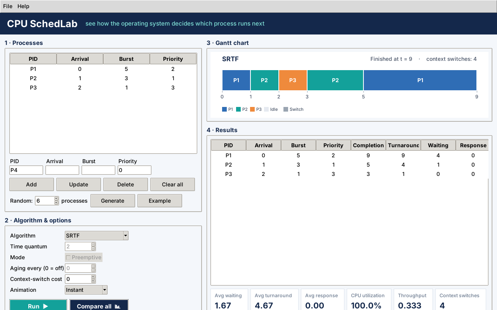
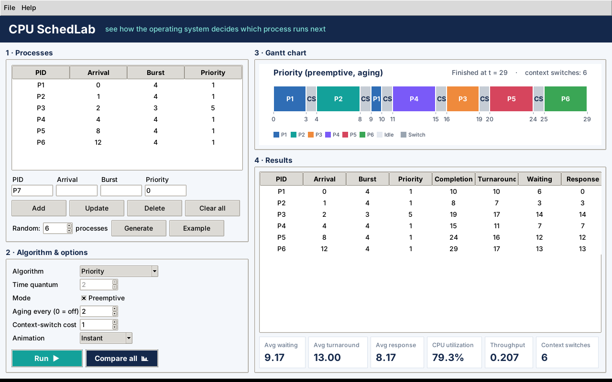
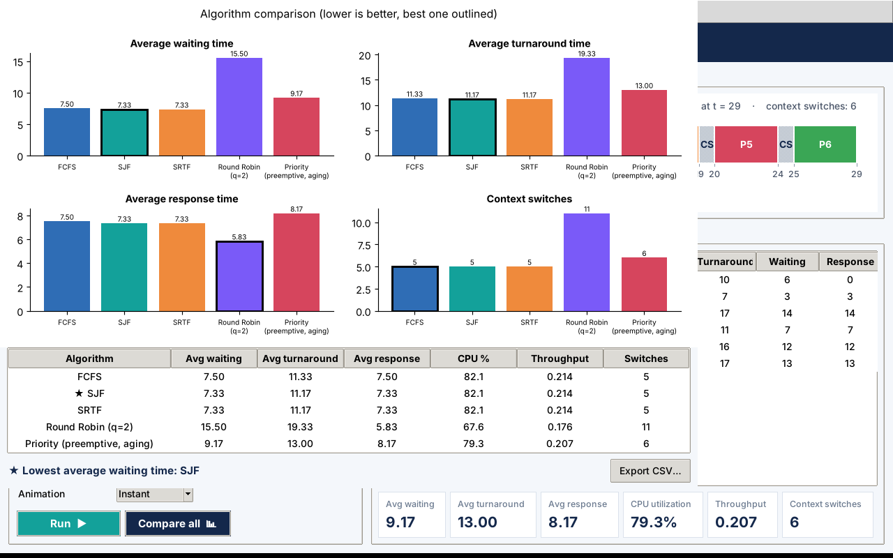

# CPU SchedLab

**An interactive simulator that shows how an operating system decides which process runs next.**

Kernel Crew · Operating Systems 2211431 · Mutah University · Dr. Wafa Altarawneh



> 📘 **The explanation guide for team members (Arabic): [docs/MEMBERS_GUIDE.md](docs/MEMBERS_GUIDE.md)**
> It tells every member exactly which files and lines to explain, with a ready script and likely questions.

---

## What it does

| | |
|---|---|
| **Simulate** | FCFS, SJF, SRTF, Round Robin and Priority (non-preemptive / preemptive + aging) |
| **Visualize** | Animated Gantt chart, including idle time and context-switch blocks |
| **Measure**   | Waiting, turnaround and response time per process and on average, CPU utilization, throughput, context switches |
| **Compare**   | Runs every algorithm on the same workload and draws bar charts |
| **Files**     | Save / load workloads and export results as CSV |

## How to run

```bash
# 1) Python 3.12 (Tkinter is included on Windows)
pip install matplotlib

# 2) open the window
python main.py

# text mode (no window) - prints every algorithm on the example
python main.py --cli
python main.py --cli --file samples/textbook_rr.csv --quantum 4
python main.py --cli --file samples/starvation.csv --aging 2

# 3) correctness tests (hand-solved examples from the proposal and the textbook)
python -m unittest -v
```

## Project structure (same design as the proposal, page 4)

```
main.py                  start the program (GUI or --cli)
schedlab/
├── models.py            Process (PCB), Segment, SchedulerOptions, ScheduleResult   ── Member 1
├── workload.py          input checking + random workload (F1, F2)                 ── Member 1
├── core.py              scheduler core: picks the algorithm and runs it           ── Member 1
├── algorithms/
│   ├── fcfs.py          F3  First Come First Served                               ── Member 1
│   ├── sjf.py           F4  Shortest Job First                                    ── Member 2
│   ├── srtf.py          F5  Shortest Remaining Time First (preemptive)            ── Member 2
│   ├── round_robin.py   F6  Round Robin                                           ── Member 3
│   └── priority.py      F7  Priority (+ preemptive mode + aging)                  ── Member 4
├── dispatcher.py        F11 builds the timeline + context-switch cost             ── Member 3
├── compare.py           F10 compare all algorithms + charts                       ── Member 3
├── metrics.py           F9  waiting / turnaround / response / utilization         ── Member 4
├── gantt.py             F8  simple Gantt chart (text + Matplotlib)                ── Member 5
├── gui.py               F8  full Tkinter window + animated Gantt chart            ── Member 5
└── storage.py           F12 save / load / export CSV                              ── Member 5
samples/                 ready workloads (proposal example, textbook examples, starvation)
tests/                   16 automatic tests
```

Every algorithm file has the **same function** `schedule(processes, options)` and returns a
`ScheduleResult` (the timeline). The GUI only talks to `core.run(...)`, so each member could build
and test their part alone.

## Verified results

| Workload | Algorithm | Avg waiting | Source |
|---|---|---|---|
| P1(0,5) P2(1,3) P3(2,1) | FCFS / SJF / SRTF | 3.33 / 2.67 / 1.67 | proposal, page 3 |
| P1(24) P2(3) P3(3) | Round Robin q=4 | 5.67 | textbook |
| P1..P5 priority example | Priority | 8.2 | textbook |
| P1(0,8) P2(1,4) P3(2,9) P4(3,5) | SRTF | 6.5 | textbook |

## Screenshots

| Priority, preemptive + aging + switch cost | Compare all algorithms |
|---|---|
|  |  |
